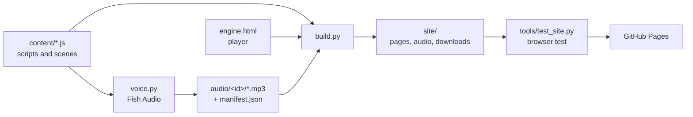

# DevOps video library

Eighteen hands-on DevOps explainer videos (Git, Kubernetes, Docker, Linux, Shell, Python, Ansible, Terraform, Jenkins, Azure DevOps, Istio, CNCF, Prometheus, Grafana, ELK, AWS, Azure, GCP). Each video is an animated HTML player with narration, captions, 1–4× speed and MP4 export. The library is built here and published to GitHub Pages:

**https://srinivaskona7.github.io/devops-html/**

## What visitors get

| | |
|---|---|
| **Watch** | Every video plays in the browser with captions. Narrated videos play the recorded voice; the others use the browser's built-in voice. |
| **Offline file** | One HTML file per video with the narration embedded. Copy it to any computer and open it in Chrome or Edge, with no internet. |
| **Download all** | `devops-videos-offline.zip`: every offline file plus subtitles. |
| **MP4** | *⬇ Download video* in the player records an MP4 with the narration (real time: a 10-minute video takes 10 minutes). |
| **Extras** | Voice-over MP3, `.srt` subtitles and the timed script for each narrated video. |
| **Replay offline** | A service worker caches watched videos, so they play again without a connection. |

## How it works



Each scene's length comes from its real narration clip, so the voice, captions and animation stay in sync.

## Repository

| Path | What |
|---|---|
| `content/<id>.js` | Script, scenes and on-screen content for each video |
| `audio/<id>/` | Recorded narration, one MP3 per scene, plus `manifest.json` (committed) |
| `engine.html` | The shared player |
| `build.py` | Builds `site/` (not committed; CI builds it) |
| `voice.py` | Generates narration with Fish Audio |
| `tools/test_site.py` | Playwright test: playback, sync, seek, speed, mute, export audio, offline files, links |
| `tools/check_layout.py` | Draws every scene of every video and fails on text that overflows or is cut off |
| `.github/workflows/pages.yml` | Build, test, deploy |

## Common tasks

```bash
# Build and test locally (needs Node, Python 3.12+, ffmpeg; the test also needs: pip install playwright)
python3 build.py
python3 tools/check_layout.py
python3 tools/test_site.py
open site/downloads/docker.html          # offline file works straight from disk

# Add narration to a video (key in ~/.fishaudio_key, never committed)
python3 voice.py kubernetes --dry-run    # shows the character count
python3 voice.py kubernetes              # only changed scenes are regenerated
git add audio/kubernetes && git commit -m "narration: kubernetes" && git push
```

Editing a scene's narration in `content/` makes its old clip stale. `build.py` then falls back to the browser voice for that video and prints `run voice.py <id>`, so the voice never goes out of sync with the captions.

## First-time GitHub Pages setup

1. Push to `main`.
2. In the repository: **Settings → Pages → Build and deployment → Source: GitHub Actions**.
3. The *Deploy to GitHub Pages* workflow builds, tests and publishes. The URL appears in the workflow summary.

## Notes

- Browsers start audio only after a click, so visitors press ▶ Play once.
- MP4 export needs desktop Chrome or Edge.
- Narration is in the cloned voice of the author, generated with Fish Audio and labelled as such in the player.
- Narration size is about 1 MB per minute of video; all 17 videos come to roughly 190 MB, within GitHub Pages limits.
